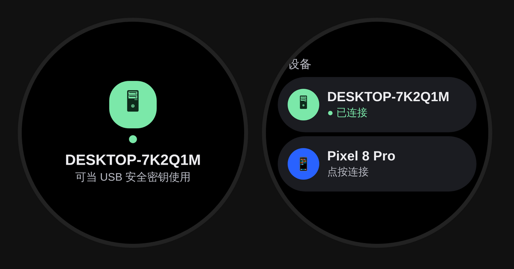

<div align="center">


</div>

<div align="center">

[](https://developer.android.com/training/wearables)
[](https://kotlinlang.org)
[](LICENSE)
[](https://github.com/Micke-y/WearAuthn/commits/master)
[](https://github.com/Micke-y/WearAuthn/stargazers)

</div>

<div align="center">
  <h3>"Raise your wrist — it's a key."</h3>
</div>

<div align="center">

English | [简体中文](./README.md)

</div>

* FIDO2 / U2F security key on a Wear OS watch, implemented against the CTAP specification.
* Talks to the host over Bluetooth; user presence and assertion generation happen on the watch.
* Private keys stay in the watch's secure element and never leave the device; signing is local.
* Supports resident keys, which enables passwordless sign-in once combined with the watch screen lock.
* Simplified Chinese interface, with tile and watch-face complication entry points.
* Watch-side installation only; no companion phone app.
* The NFC channel is currently unverified. See "Compatibility and Verification Status".

> Note: this is an unofficial Simplified Chinese build based on [fmeum/WearAuthn](https://github.com/fmeum/WearAuthn) (MIT License, © 2019 Fabian Henneke). The CTAP implementation, the security model and the original design all belong to the upstream author.

---

<div align="center">



<sub>Interface preview (Simplified Chinese UI, rendered from source rather than captured on a device)</sub>

</div>

## Overview

Wear OS devices ship a dedicated secure element, originally used to store Google Pay keys. This app reuses that hardware to implement a FIDO2 security key: when a host browser issues an authentication request, the watch performs user verification and returns a signed assertion, which the site uses to complete sign-in or second-factor verification.

Credentials are bound to the origin, so a phishing site cannot obtain a valid assertion even if it copies the login page verbatim.

## Features

- FIDO2 / U2F authentication (CTAP2)
- Bluetooth channel: pair with a computer and use it as a security key
- NFC channel: near-field mode for phones, **currently unverified**
- Resident keys and passwordless sign-in
- Simplified Chinese interface
- Tile and watch-face complication entry points

## Installation

Install a single APK on the watch:

```bash
adb install -r WearAuthn-<version>.apk
```

Developer options and ADB debugging must be enabled on the watch first. Without a cable, enable wireless debugging and install through a wireless ADB tool such as Wear OS Toolbox. Once installed, add the tile to quick settings or assign the complication on your watch face to this app.

## Compatibility and Verification Status

| Platform | Channel | Status |
| --- | --- | --- |
| Windows (Bluetooth) | Paired computer | Verified · tested locally |
| macOS / ChromeOS / Linux | Bluetooth | Unverified · supported per upstream docs |
| Android | NFC | Unverified · test unsuccessful |
| iPhone | NFC | Unverified |

> **NFC: pending.** Attempts on a Xiaomi phone did not complete authentication, and the cause has not been identified, so this channel cannot be confirmed working in the current build. The Bluetooth channel is unaffected. If you get it working on another device, please open an issue with the model and OS version.

## Security Notes

Configure at least one backup authentication method for every account that registers this key: a backup key, recovery codes, or another authenticator.

If the device is lost, factory-reset, or the app is uninstalled, the key material cannot be recovered and the associated accounts may become inaccessible. This is an inherent constraint of hardware security keys, not a defect of this app.

## Source and License

- Upstream: [fmeum/WearAuthn](https://github.com/fmeum/WearAuthn), MIT License, © 2019 Fabian Henneke.
- This repository is an unofficial Simplified Chinese build, not affiliated with the upstream author or the official Google Play release.
- Under the MIT license you may use, modify and redistribute freely, provided the copyright and license notices are retained. See [MODIFICATIONS.md](MODIFICATIONS.md) for the scope of changes.

## Acknowledgements

Thanks to [Fabian Henneke](https://github.com/fmeum) for open-sourcing the complete CTAP implementation and the project itself.
