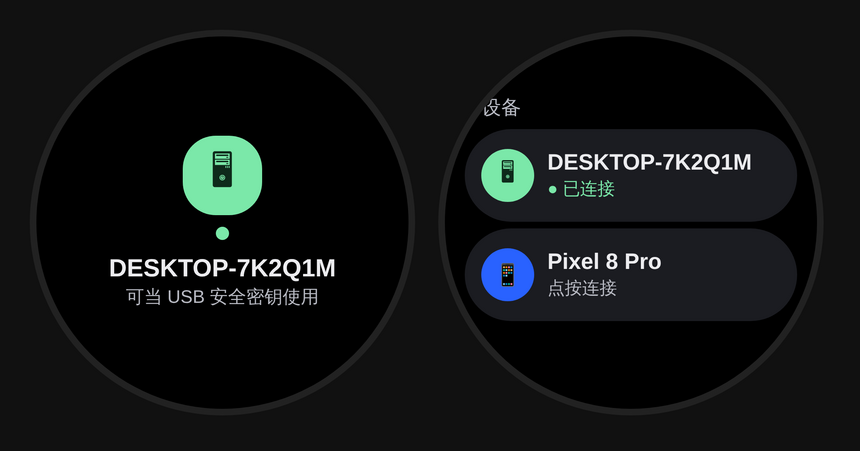

<div align="center">


</div>

<div align="center">

[](https://developer.android.com/training/wearables)
[](https://kotlinlang.org)
[](LICENSE)
[](https://github.com/Micke-y/WearAuthn/commits/master)
[](https://github.com/Micke-y/WearAuthn/stargazers)

</div>

<div align="center">
  <h3>"抬手，就是一把钥匙"</h3>
</div>

<div align="center">

简体中文 | [English（上游原版说明）](https://github.com/fmeum/WearAuthn)

</div>

* 把 Wear OS 手表当成 FIDO2 / U2F 安全密钥用，登录网页时在表上点一下确认。
* 电脑走蓝牙，手机走 NFC，不需要额外的硬件密钥。
* 私钥留在手表的安全芯片里，网站拿到的是签名，不是密码。
* 支持免密登录：某些站点确认一下手表锁屏就能登进去，不用输账号密码。
* 界面全中文，支持磁贴和表盘快捷入口。
* 手表上装一个 apk 就能用，不需要手机端配套 App。

> 注：本项目是非官方中文版，改自 [fmeum/WearAuthn](https://github.com/fmeum/WearAuthn)（MIT License，© 2019 Fabian Henneke）。底层的能力、CTAP 实现和安全模型都来自原作者。

---

<div align="center">



<sub>界面预览</sub>

</div>

## 🎯 它是什么

Wear OS 手表里本来就有独立的安全芯片，原本是给 Google Pay 存密钥用的。这个 App 把那套硬件能力拿来做 FIDO2 安全密钥，手表就成了一枚戴在手上的 U 盾。

用起来是这样：浏览器弹出"请插入安全密钥"，手表上出现确认，点一下就登录完成。手机没有 USB 口，就用 NFC，把表贴到手机背面。

相比短信验证码和验证器 App，安全密钥绑的是域名。钓鱼站把登录页整个抄过去也没用，域名不对，签名就不会生成。

## ✨ 能干什么

- 网站登录、二次验证时充当硬件安全密钥
- 蓝牙连接电脑，NFC 连接手机
- 手表上点一下确认，不用掏手机
- 支持免密登录（resident key）
- 全中文界面
- 磁贴、表盘复杂功能两种快速入口

## 📲 怎么装

手表上装一个 APK 就行：

```bash
adb install -r WearAuthn-vX.X.X.apk
```

没有数据线的话，用手机上的侧载工具（比如 Wear Installer）也能装。装完把磁贴加到快捷设置，或者把表盘上的复杂功能指到它，抬手就能用。

## 🖥️ 兼容性

| 平台 | 连接方式 |
| --- | --- |
| Windows / macOS / ChromeOS / Linux | 蓝牙配对后当安全密钥 |
| Android / iPhone | NFC，贴手机背面 |

兼容性以[上游说明](https://github.com/fmeum/WearAuthn)为准。自己没实测过的组合，遇到问题欢迎开 issue。

## 🔐 安全提醒

拿手表当安全密钥，**一定同时留个后路**：备用密钥、恢复码，或者另一个验证器。

表丢了、刷了机、App 删了，密钥跟着一起没，那个账号可能就再也进不去。这是所有硬件密钥的通病，不是这个 App 的毛病，但特别容易忘。

## 📄 来源与许可

- 上游：[fmeum/WearAuthn](https://github.com/fmeum/WearAuthn)，MIT License，© 2019 Fabian Henneke。
- 本仓库是非官方中文修改版，与原作者及 Google Play 上的官方版本没有隶属关系。
- 按 MIT 协议，可以自由使用、修改、再分发，保留版权声明即可。改动依据见 [MODIFICATIONS.md](MODIFICATIONS.md)。

## 🙏 致谢

感谢 [Fabian Henneke](https://github.com/fmeum) 把整套 CTAP 栈和这个想法开源出来，没有原版就没有这一版。
