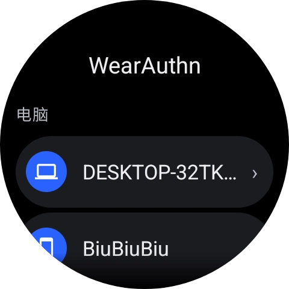
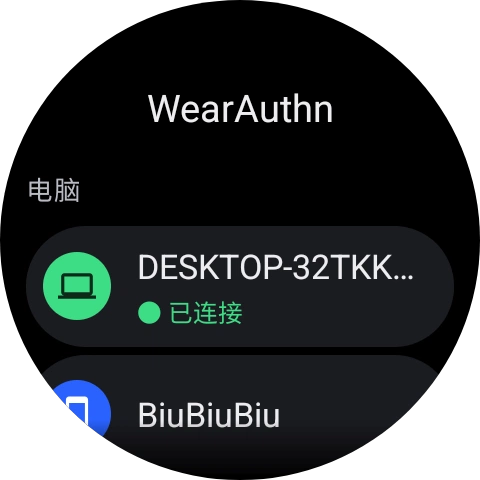
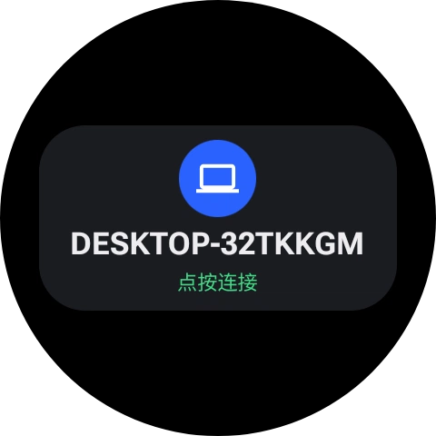
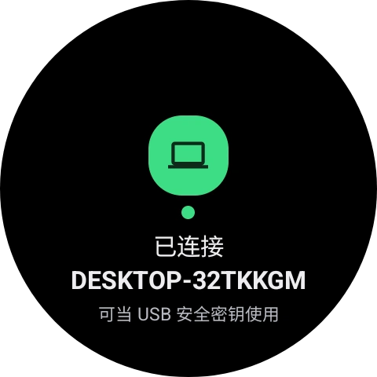
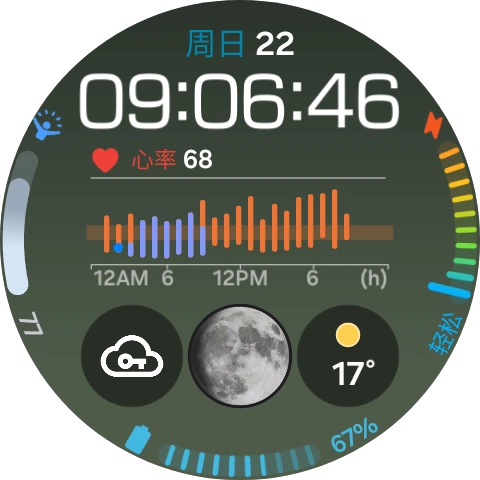

<h1>WearAuthn</h1>

  <h3>"抬手，就是一把钥匙"</h3>

简体中文 | [English](./README.en.md) | [更新日志](./CHANGELOG.md)

* 在 Wear OS 手表上实现 FIDO2 / U2F 安全密钥功能，遵循 CTAP 规范。
* 通过蓝牙与主机通信，在手表端完成用户确认并生成签名断言。
* 私钥由手表的安全芯片保管，不离开设备，签名在本地完成。
* 支持常驻凭据（resident key），可结合屏幕锁实现免密登录。
* 界面为简体中文，提供磁贴与表盘复杂功能两种入口。
* 仅需在手表侧安装，无配套手机应用。
* NFC 通道目前未验证，详见「兼容性与验证状态」。

> 注：本项目为非官方简体中文版本，基于 [fmeum/WearAuthn](https://github.com/fmeum/WearAuthn)（MIT License，© 2019 Fabian Henneke）修改。CTAP 实现、安全模型与原始设计均归原作者所有。

---

## 📷 界面

实机截图：Samsung Galaxy Watch 7，One UI Watch 8.0（Wear OS 6）。

**应用主界面**

| 未连接 | 已连接 |
| --- | --- |
|  |  |

**磁贴（Tile）**

| 未连接 · 点按连接 | 已连接 |
| --- | --- |
|  |  |

**表盘界面**

| 复杂功能入口指向本应用 |
| --- |
|  |

## 🎯 概述

Wear OS 设备内置独立的安全芯片，原本用于 Google Pay 的密钥存储。本应用复用该硬件能力实现 FIDO2 安全密钥：主机浏览器发起认证请求后，手表完成用户确认并返回签名断言，站点据此完成登录或二次验证。

凭据与源站域名绑定，即便登录页面被完整复制，钓鱼站点也无法获得有效断言。

## ✨ 功能

- FIDO2 / U2F 认证（CTAP2）
- 蓝牙通道：与电脑配对后作为安全密钥使用
- 常驻凭据（resident key）与免密登录
- 简体中文界面
- 磁贴、表盘复杂功能两种入口

## 🚧 未验证的功能

- **NFC 通道**：面向手机的近场方式。已在小米手机上实测未能跑通，暂不承诺可用，详见「兼容性与验证状态」。

## 🧩 快捷入口

手表上不必翻应用列表，两种方式都能直接进入：

- **磁贴（Tile）**：加入快捷设置后，从表盘下拉即可进入应用。
- **表盘复杂功能（Complication）**：在表盘上指定一个位置，点击该位置即启动。

## 📲 安装

手表侧安装单个 APK。需先在手表上开启开发者选项与 ADB 调试；没有数据线时，可开启无线调试，借助 Wear OS 工具箱等无线 ADB 工具完成安装。安装完成后，可在快捷设置中添加磁贴，或在表盘上将复杂功能指向本应用。

## 🖥️ 兼容性与验证状态

### 🧪 测试环境

- **手表**：Samsung Galaxy Watch 7，One UI Watch 8.0（Wear OS 6）
- **主机**：Windows 11，蓝牙配对
- **测试站点**：[webauthn.io](https://webauthn.io/)（WebAuthn 官方演示站，Duo Labs 维护）
- **NFC**：未验证

| 平台 | 通道 | 状态 |
| --- | --- | --- |
| Windows 11（蓝牙） | 电脑配对后作为安全密钥 | 已验证 · Galaxy Watch 7 实测可用 |
| macOS / ChromeOS / Linux | 蓝牙 | 未验证 · 上游文档有支持 |
| Android | NFC | 未验证 · 实测未成功 |
| iPhone | NFC | 未验证 |

> **NFC：待定。** 已在小米手机上尝试，未能成功完成认证，原因尚未定位，因此无法确认该通道在当前版本可用。蓝牙通道不受影响。若在其他机型上跑通，欢迎开 issue 说明机型和系统版本。

## 🔐 安全须知

建议为每个登记该密钥的账户配置至少一项备用认证方式：备用密钥、恢复码或其他验证器。

设备丢失、恢复出厂设置或应用被卸载后，密钥材料不可恢复，相关账户可能无法登录。这是硬件安全密钥的固有约束，并非本应用的缺陷。

## 📄 来源与许可

- 上游项目：[fmeum/WearAuthn](https://github.com/fmeum/WearAuthn)，MIT License，© 2019 Fabian Henneke。
- 本仓库为非官方简体中文修改版，与原作者及 Google Play 上的官方版本无隶属关系。
- 依 MIT 许可，可自由使用、修改与再分发，保留版权与许可声明即可。改动范围见 [MODIFICATIONS.md](MODIFICATIONS.md)。

## 🙏 致谢

感谢 [Fabian Henneke](https://github.com/fmeum) 将完整的 CTAP 实现与项目本体开源。
