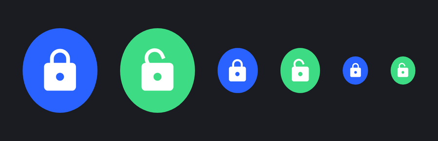

<div align="center">


</div>

<div align="center">

[](https://developer.android.com/training/wearables)
[](https://kotlinlang.org)
[](LICENSE)
[](https://github.com/Micke-y/WearAuthn/commits/master)
[](https://github.com/Micke-y/WearAuthn/stargazers)
[](https://github.com/Micke-y/WearAuthn/pulls)

</div>

<div align="center">
  <h3>"抬手，就是一把钥匙"</h3>
</div>

<div align="center">

简体中文 | [English（上游原版说明）](https://github.com/fmeum/WearAuthn)

</div>

* 把 Wear OS 手表当成 FIDO2 / U2F 安全密钥用，蓝牙和 NFC 两条路都能走。
* 私钥不离开手表的安全芯片，登录时在表上点一下确认，网站拿到的是签名，不是密码。
* 支持 resident key（免密登录）：某些站点只要确认一下手表的屏幕锁就能登进去，不用输账号密码。
* 这一版把界面全量翻成中文，主界面按 Wear Material 3 Expressive 重画，磁贴和表盘入口的毛病一并修了。
* 只需要在手表上装一个 apk，不用手机端配套 App。
* Kotlin 写的，MIT 协议，能自己编译。

> 注：本项目是非官方中文版，改自 [fmeum/WearAuthn](https://github.com/fmeum/WearAuthn)（MIT License，© 2019 Fabian Henneke）。原版的能力设计、CTAP 实现和安全模型都是原作者做的，这一版只负责中文界面和下面列出的那些改动。

---

<div align="center">


<sub>界面预览（按代码渲染的设计稿，实测截图见 Release 说明）</sub>

</div>

## 🎯 它是什么

Wear OS 的手表里本来就有独立的安全芯片，原本是给 Google Pay 存密钥用的。这个 App 把那套硬件能力拿来做 FIDO2 安全密钥，于是你的手表就变成了一枚可以戴在手上的 U 盾。

用起来是这样：电脑浏览器弹出"请插入安全密钥"，手表上弹出确认，点一下，登录就完成了。手机上没有 USB 口，就用 NFC，把表贴到手机背面即可。

比起短信验证码和 TOTP，安全密钥的好处是绑域名。钓鱼站把你的登录页整个抄过去，域名不对，签名就不会生成。这个能力是短信和六位数字给不了的。

## ✨ 这一版改了什么

| 项目 | 原版 | 这一版 |
| --- | --- | --- |
| 界面语言 | 英文 | 全量简体中文 |
| 主界面 | 原版布局 | 按 Wear Material 3 Expressive 重构，蓝=未连接、绿=已连接 |
| 磁贴 | 点击位置偏下、二次连接常无响应 | 落点对齐，连接逻辑重做 |
| 表盘入口 | 点了不响应 | 正常拉起 |
| 连接保持 | 回到表盘即断开 | 回到主界面仍保持连接，随时能再确认 |
| 免密登录 | 开启后置灰，不可撤销 | 可开可关的双向开关 |
| 应用图标 | 单色 | 沿用"云 + 钥匙"构图，One UI 蓝底 + 白色 |

免密开关的两个状态，锁头会跟着变：

<div align="center">



</div>

左边蓝底闭合锁是关，右边绿底开锁是开。关掉免密之后，要求"用户验证"的网站会拒绝之前登记的凭据，得重新登记一次 —— 这个代价在确认框里写明了。

## 📲 怎么装

只需要在手表上装一个 APK，不需要手机端配套 App。

```bash
adb install -r WearAuthn-vX.X.X.apk
```

没有数据线的话，用手机上的侧载工具（比如 Wear Installer）也能装。装完做两件事就顺手了：

1. 把磁贴加到快捷设置，下拉就能看到。
2. 把表盘上的复杂功能指到它，抬手点一下就进。

## 🖥️ 兼容性

原版说明里覆盖的组合，接线方式分两类：

| 平台 | 方式 |
| --- | --- |
| Windows / macOS / ChromeOS / Linux | 蓝牙配对后当安全密钥 |
| Android / iPhone | NFC，贴手机背面 |

兼容性以[上游说明](https://github.com/fmeum/WearAuthn)为准。我只在自己手上的设备实测过，其他组合没一一验证，遇到问题欢迎开 issue。

## 🔐 安全提醒

拿手表当安全密钥，**一定要同时留个后路**：备用密钥、恢复码，或者另一个验证器。

表丢了、刷了机、App 删了，密钥跟着一起没，那个账号可能就再也进不去。这是所有硬件密钥的通病，不是这个 App 的毛病，但确实特别容易忘。

## 🧩 几个常问的

- **关掉免密还能再开回来吗？** 能。这一版把原来"开了就锁死"的限制去掉了，可以来回切。
- **换手表或者恢复出厂设置之后呢？** 跟所有安全密钥一样，密钥没了，得重新在各网站登记。
- **为什么装的时候提示"未知来源"？** 侧载的 APK 都会提示，这是系统的正常行为。
- **会不会拖累续航？** 主要开销是保持蓝牙连接，不用的时候把 App 退到表盘之外就不会一直挂着。

## 🔨 自己编译

```bash
# 需要 JDK 17 和 Android SDK（platform 34 + build-tools 34.0.0）
echo "sdk.dir=/path/to/android-sdk" > local.properties
./gradlew :authenticator:assemblePlayStoreRelease
```

产物在 `authenticator/build/outputs/apk/playStore/release/`。仓库里那两个 `*_keystore.jks` 是上游留下的公开测试密钥，只用于 CI，**不要拿它对外发布**。

## 📄 来源与许可

- 上游：[fmeum/WearAuthn](https://github.com/fmeum/WearAuthn)，MIT License，© 2019 Fabian Henneke。
- 本仓库是它的非官方中文修改版，与原作者及 Google Play 上的官方版本没有隶属关系。
- 按 MIT 协议，你可以自由使用、修改、再分发，保留版权声明即可。改过哪些文件、依据哪条协议，见 [MODIFICATIONS.md](MODIFICATIONS.md)。

## 🙏 致谢

感谢 [Fabian Henneke](https://github.com/fmeum) 把整个 CTAP 栈和这个想法开源出来，没有原版就没有这一版。
